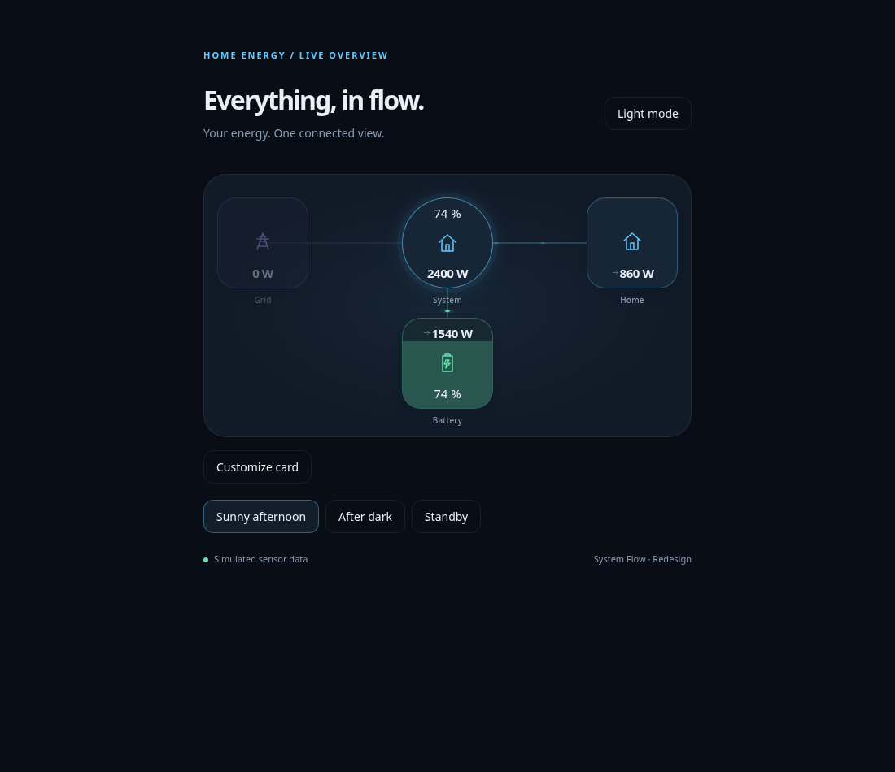

# System Flow Card

## Modern redesign

This fork keeps the existing `custom:system-flow-card` YAML format and adds themed sensor tiles, entity labels, a highlighted central node, glowing directional flow particles, smooth fill and idle transitions, and a compact layout for narrow cards. It follows Home Assistant theme colors and the browser's reduced-motion preference. Flow animation durations are bounded to keep very small and large sensor values readable.

The installable file is **`dist/system-flow-card.js`**. Install this fork through a HACS custom repository as described below, or back up and replace your existing resource manually, then refresh the dashboard cache. Existing entity IDs and configuration can stay as they are.

The layout only allocates rows for configured sensors: removing the top or bottom sensors reduces card height immediately. Connector positions follow the remaining nodes, including multiple side sensors. Open `demo/?compact` for an example without solar panels. Browser checks cover compact layouts and connector endpoints at 320px and 600px widths.

### Visual editor

In Home Assistant, edit the dashboard, open the card menu, and choose **Edit**. The visual editor supports title, animation timing, idle fading, the central system node (including sensor override), sensor selection, separate production/consumption entities, position, icon, color picker, unit, fill level, inversion, exclusion, and extra readings. Add or remove sensors using the editor buttons, then use Home Assistant's **Save** button. Existing YAML and unknown configuration keys are preserved. Top and bottom rows remain limited to two sensors, and the last sensor cannot be removed.

The bundled editor uses Home Assistant's native `ha-form` controls and entity/icon pickers through its [custom card editor API](https://contributors.home-assistant.io/frontend/custom-ui/card-editor/). No additional resource is needed: replace `dist/system-flow-card.js` and refresh the browser cache.

The demo's **Customize card** button opens the same editor with lightweight stand-ins for Home Assistant controls. Changes immediately update the preview and reset on reload; the demo does not save your actual dashboard.

### Publishing updates

Update the version in `package.json` and `package-lock.json`, run the checks, rebuild and commit `dist/system-flow-card.js`, and push to `main`. After CI passes, run **Actions → Release → Run workflow** with the matching tag (for example `v1.0.1`). The workflow attaches the compiled JavaScript to the GitHub release for HACS.

### Preview and verify

From the project directory, run `python3 -m http.server 8765 --bind 127.0.0.1` and open **http://127.0.0.1:8765/demo/**. The demo runs the real compiled card with simulated Home Assistant entities. Its buttons switch between production, discharge and idle scenarios and between light and dark themes. Add `?test` to run browser assertions; success sets `data-test-result="passed"` on the page body. `?light` opens the light theme directly.

Build with `npm ci --legacy-peer-deps` followed by `npm run build`. Type-check with `node node_modules/typescript/bin/tsc --noEmit` and lint with `npm run lint`.

CSS container queries and `color-mix()` require a modern browser. Actual Home Assistant integration must still be checked against your dashboard and sensor configuration.


## Origin

This is a redesigned fork of [samuelolteanu/system-flow-card](https://github.com/samuelolteanu/system-flow-card), based on [flyrmyr/system-flow-card](https://github.com/flyrmyr/system-flow-card). Original configuration options and credits are retained below.



## Install

### HACS (recommended)

1. If the original System Flow Card is installed, save a copy of your card YAML and remove the original package from HACS. Keep the dashboard cards themselves.
2. Open **HACS → ⋮ → Custom repositories**.
3. Add `https://github.com/scatari69/system-flow-card` with category **Dashboard** (called **Lovelace** in some older HACS versions).
4. Find **System Flow Card — Modern**, download the latest release, and reload the browser.
5. In **Settings → Dashboards → ⋮ → Resources**, keep one JavaScript Module entry for `/hacsfiles/system-flow-card/system-flow-card.js`. Remove duplicate or old manual resource URLs. If the old appearance is cached, append `?v=1.0.0` to this URL and hard-refresh.
6. Edit an existing `custom:system-flow-card` to open the visual editor, or add **System Flow Card — Modern** from the card picker.

The custom element name stays `system-flow-card`, so existing YAML does not need renaming. Load only this fork's JavaScript: loading the original and this fork together causes a duplicate custom-element registration.

[Add this repository to HACS](https://my.home-assistant.io/redirect/hacs_repository/?owner=scatari69&repository=system-flow-card&category=plugin)

### Установка через HACS

В HACS откройте **⋮ → Пользовательские репозитории**, добавьте `https://github.com/scatari69/system-flow-card` с категорией **Панель управления / Dashboard** и установите **System Flow Card — Modern**. Если оригинальная версия уже установлена, сначала сохраните YAML и удалите её пакет через HACS; сами карточки на панели оставьте. После установки проверьте, что ресурс `/hacsfiles/system-flow-card/system-flow-card.js` подключён только один раз, и обновите страницу без кеша. Тип `custom:system-flow-card` остаётся прежним.

### Manual install

1. Download and copy `system-flow-card.js` from the [latest release](https://github.com/scatari69/system-flow-card/releases/latest) into your `config/www` directory.

2. Add the resource reference as decribed below.

### Add resource reference

If you configure Dashboards via YAML, add a reference to `system-flow-card.js` inside your `configuration.yaml`:

```yaml
resources:
  - url: /local/system-flow-card.js
    type: module
```

Else, if you prefer the graphical editor, use the menu to add the resource:

1. Make sure, advanced mode is enabled in your user profile (click on your user name to get there)
2. Navigate to Settings -> Dashboards
3. Click three dot icon
4. Select Resources
5. Hit (+ ADD RESOURCE) icon
6. Enter URL `/local/system-flow-card.js` and select type "JavaScript Module".
   (Use `/hacsfiles/system-flow-card/system-flow-card.js` and select "JavaScript Module" for HACS install if HACS didn't do it already)

## Using the card

I recommend looking at the [Example usage section](#example-usage) to understand the basics to configure this card.
(also) pay attention to the **required** options mentioned below.

### Options

#### Card options

| Name              | Type     |    Default    | Description |
| ----------------- | -------- | :-----------: | ------------|
| type              | `string` | **required**  | `custom:system-flow-card`.
| title             | `string` |               | Shows a title at the top of the card.
| system            | `object` |               | Define parameters of the central `System` element, see [system object](#system-object) for additional system element options.
| elements          | `object` | **required**  | One or more sensor entities, see [element object](#element-object) for additional entity options.
| speed             | `string` | 5             | Define the average time (s) for dots to travel.         
| fadeIdylElements  | `string` |               | Fade elements that are not currently producing or consuming.

#### System object
The system is essentially an [element object](#element-object). The `value` is calculated from the difference in providers and consumers in the system (a positive value shows net unaccounted for production). This element has a central position.

| Name           | Type        |    Default    | Description |
| -------------- | ----------- | :-----------: | ----------- |
| unit           | `string`    | entity unit   | Display unit for the element value
| icon           | `string`    |               | Display icon for the element
| color          | `string`    |               | Hex color for the element box
| invert         | `boolean`   | false         | Invert the calculated system value (useful if your net calculation results in a negative number).
| override       | `boolean`   | false         | **New:** Set to `true` to display a specific sensor value instead of the calculated result.
| value          | `string`    |               | **New:** If `override` is true, this Entity ID will be displayed in the center (e.g., `sensor.total_grid`).
| extra          | `object`    |               | Extra sensor values to display within the element box. See [element extra object](#element-extra-object) for additional extra options.

#### Element object

| Name           | Type        |    Default    | Description |
| -------------- | ----------- | :-----------: | ----------- |
| value          | `string` / `object` | **required** | Entity ID of a sensor providing a state value, (positive values for element consumption) (unless the `inverted` option is set to true) **or** a split value object. See [element value object](#element-value-object) for split value options.
| unit           | `string`    | `entity.unit` | Display unit for the element value
| position       | `string`    | **required**  | Placement of entity box. Must be either `top` `left` `bottom` or `right`
| icon           | `string`    |               | Display icon for the element
| color          | `string`    |               | Hex color for the element box
| fill           | `string`    |               | Entity ID of a sensor providing a state of 0 - 100 (%) fill of the element box
| invert         | `boolean`   | false         | Invert element value for the system flow calculation
| exclude        | `boolean`   | false         | Exclude element value from the system flow calculation
| extra          | `object`    |               | Extra sensor values to display within the element box. See [element extra object](#element-extra-object) for additional extra options.

#### Element value object

| Name           | Type     | Description |
| -------------- | -------- | ----------- |
| fromSystem     | `string` | Entity ID of a sensor providing a state value for consumption
| toSystem       | `string` | Entity ID of a sensor providing a state value for production

#### Element extra object

| Name           | Type     | Description |
| -------------- | -------- | ----------- |
| main           | `string` | Entity ID of a sensor providing a state value to display. The sensors `entity.unit` will be displayed.
| left           | `string` | Entity ID of a sensor providing a state value to display. The sensors `entity.unit` will be displayed.
| right          | `string` | Entity ID of a sensor providing a state value to display. The sensors `entity.unit` will be displayed.

### Example usage

#### My Latest Example

For those testing, here is my current config:

```yaml
type: custom:system-flow-card
speed: 3
fadeIdylElements: true
system:
  unit: W
  icon: mdi:rv-truck
  extra: sensor.indoor_govee_temperature
  color: '#0089b6'
elements:
  - value: sensor.victron_multiplus_activein_l1_power_238
    icon: mdi:power-socket-au
    position: left
    color: '#B62D00'
    extra:
      main: sensor.victron_multiplus_state_238
      left: sensor.victron_multiplus_activein_l1_voltage_238
      right: sensor.victron_multiplus_activein_l1_current_238
  - value: sensor.victron_alternator_power
    icon: mdi:engine
    position: left
    color: '#f67828'
    extra:
      left: sensor.victron_alternator_battery_voltage
      right: sensor.victron_alternator_battery_current
  - value: sensor.victron_battery_power
    invert: true
    icon: mdi:car-battery
    extra:
      main: sensor.victron_system_battery_soc
      left: sensor.victron_system_battery_voltage
      right: sensor.victron_system_battery_current
    fill: sensor.victron_system_battery_soc
    position: bottom
    color: '#3FF628'
  - value: sensor.victron_solar_pv_power
    icon: mdi:solar-power-variant
    extra:
      main: sensor.victron_solar_yield_today
      left: sensor.victron_solar_pv_voltage
      right: sensor.victron_solar_pv_current
    position: top
    color: '#F6DF28'
    fill: sensor.solar_effectiveness_today
  - value: sensor.victron_ac_consumption
    icon: mdi:power-plug
    position: right
    color: '#B62D00'
    invert: true
    extra:
      main: sensor.victron_multiplus_state_238
      left: sensor.victron_multiplus_out_l1_voltage_238
      right: sensor.victron_multiplus_out_l1_current_238
  - value: sensor.victron_dc_system_power
    invert: true
    icon: mdi:lightning-bolt-circle
    position: right
    color: '#0089b6'
```


## Credits

- [HA Energy Distribution Card](https://www.home-assistant.io//dashboards/energy/#energy-distribution)
- [@angular/cdk](https://github.com/angular/components/tree/main/src/cdk)
- [Jack Moore](https://www.jacklmoore.com/notes/rounding-in-javascript/)
- [ulic75](https://github.com/ulic75/power-flow-card)
